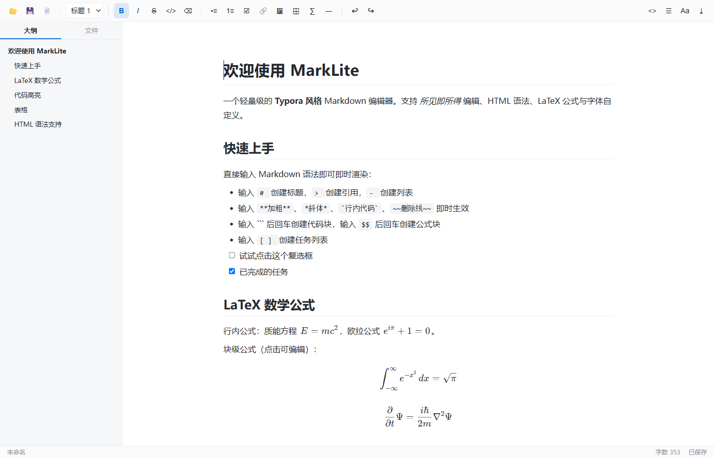
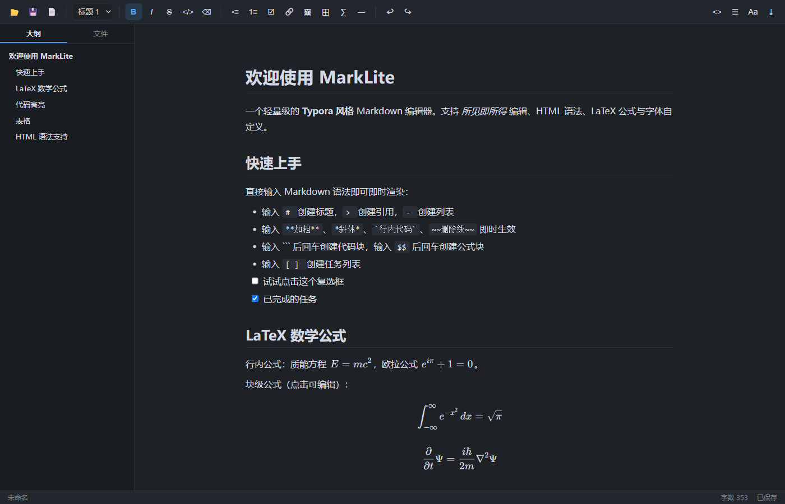

# MarkLite — 轻量级 Typora 风格 Markdown 编辑器

纯静态 Web 应用，无需安装、无需构建、完全离线可用。所有第三方库均已本地化（`vendor/` 目录，共约 1.1 MB）。





## 启动方式

**方式一（推荐）**：双击 `start.bat`（Windows）或运行 `sh start.sh`（macOS / Linux），自动打开浏览器并启动本地服务。

**方式二**：`node server.js`，然后访问 <http://localhost:8899>

**方式三**：直接双击 `index.html`（文件拖拽打开、导出等基础功能可用；打开/保存对话框功能在 Chrome / Edge 中体验最佳）。

> AI 写作助手需要方式一/二启动，且本机安装有 Claude Code CLI（`claude` 命令可用，无需额外配置 API key）。

## 在别的电脑上使用（零依赖）

应用本体是**纯静态文件**，`index.html + css/ + js/ + vendor/` 就是全部，**无需 npm install、无需构建、完全离线**：

1. `git clone git@github.com:Evenstar-E/typora_fake.git`（或下载 ZIP 解压）
2. 双击 `index.html` 即可编辑 Markdown；有 Node.js 的话运行 `node server.js` 获得完整体验（文件对话框、AI 助手）
3. 可选增强：安装 Node.js（运行服务器）、Chrome / Edge（File System Access API、文件夹授权）、Claude Code CLI（AI 功能）
4. 运行测试才需要 `npm install`（jsdom + puppeteer-core，均为 devDependencies，与应用运行无关）

## 功能一览

| 功能 | 说明 |
| --- | --- |
| 所见即所得编辑 | 输入 Markdown 语法即时渲染，与 Typora 一致 |
| 行内快捷键 | `**加粗**` `*斜体*` `` `代码` `` `~~删除线~~` `$公式$` `[文字](链接)` |
| 块级快捷键 | `# ` 标题、`> ` 引用、`- ` 列表、`1. ` 有序列表、`[ ] ` 任务列表、` ``` `+回车 代码块、`$$`+回车 公式块、`---`+回车 分割线 |
| LaTeX 公式 | 行内 `$...$`、块级 `$$...$$`，KaTeX 渲染，点击公式即可编辑 |
| HTML 语法 | 内嵌 HTML 标签（`<u>` `<mark>` `<sup>` `<sub>` `<details>` 等）实时渲染并原样保存 |
| 代码高亮 | highlight.js，支持百余种语言，聚焦代码块时可编辑纯文本 |
| 字体自定义 | **中西文正文字体分开设置**（西文 Georgia/Palatino/Times… × 中文雅黑/宋体/楷体…）、代码字体、字号、行高、内容宽度 |
| 主题 | 明亮 / 夜间 / 书卷 三套主题 |
| 大纲 | 左侧栏标题导航，点击跳转 |
| 查找替换 | Ctrl+F 查找、Enter/Shift+Enter 上下跳转、替换/全部替换（高亮基于 CSS Highlight API，替换可撤销） |
| AI 写作助手 | 工具栏 ✨ 打开：润色/精简/扩写/续写/翻译/总结/纠错快捷指令 + 自定义指令；基于选区或全文上下文，结果可替换选区/插入光标处/复制。通过 server.js 调用**本机 Claude Code CLI**（无需 API key，流式输出，禁用全部 agent 工具保证安全） |
| 专注/打字机 | 设置面板开启：非当前段落淡出 / 光标行保持视口中部 |
| 文件 | 打开 / 保存 / 另存为 / 拖拽打开 / 最近文件 / 未保存草稿自动恢复 |
| 图片 | 粘贴 / 拖拽插入；相对路径图片一次性授权文件夹后自动解析显示（兼容 `?query`、`../` 上层路径、大小写不一致、URL 编码文件名），保存始终写回原始路径 |
| 导出 | 自包含 HTML（内联样式）、打印 / PDF、另存 Markdown |
| 源码模式 | `Ctrl+/` 切换到 CodeMirror 源码编辑，双向同步 |

## 快捷键

| 快捷键 | 功能 |
| --- | --- |
| Ctrl+Z / Ctrl+Y / Ctrl+Shift+Z | 撤销 / 恢复（快照式，覆盖输入、自动格式化、工具栏命令等全部操作） |
| Ctrl+S / Ctrl+Shift+S | 保存 / 另存为 |
| Ctrl+O / Ctrl+N | 打开 / 新建 |
| Ctrl+B / Ctrl+I | 加粗 / 斜体 |
| Ctrl+K | 插入链接 |
| Ctrl+F | 查找替换 |
| Ctrl+1 ~ Ctrl+6 | 标题 1~6 |
| Ctrl+0 | 正文 |
| Ctrl+/ | 源码模式切换 |
| Tab / Shift+Tab | 列表缩进 |
| Ctrl+Enter（代码块内） | 跳出代码块 |

## 技术栈

- [markdown-it](https://github.com/markdown-it/markdown-it) — Markdown 解析（自定义公式、任务列表规则）
- [KaTeX](https://katex.org/) — LaTeX 数学公式渲染
- [highlight.js](https://highlightjs.org/) — 代码语法高亮
- [Turndown](https://github.com/mixmark-io/turndown) + GFM 插件 — HTML → Markdown 序列化（保存）
- [CodeMirror 5](https://codemirror.net/5/) — 源码编辑模式

## 目录结构

```
typora_fake/
├── index.html          应用入口
├── css/                主题 / 排版 / 框架样式
├── js/                 渲染管线 / 序列化 / 编辑器 / 文件IO / UI
├── vendor/             本地化的第三方库（离线可用）
├── server.js           零依赖静态服务器
├── start.bat           一键启动
└── test/               自动化测试（node test/roundtrip.js / smoke.js）
```

## 测试

```bash
node test/roundtrip.js   # Markdown↔HTML 往返序列化测试（Node + jsdom）
node test/smoke.js       # 浏览器端冒烟测试（调用系统 Edge/Chrome 无头模式）
```
